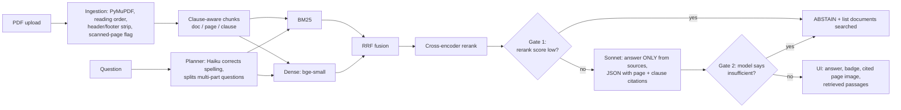

# LexiSyncAI – evidence-grounded legal document analyst

Ask questions about 2–5 public legal PDFs and get a plain-language answer with **page + clause citations**,
a confidence badge, the cited page shown side by side, and **abstention** when the documents lack the evidence.

## Architecture


## Setup (Windows PowerShell, Python 3.12 via conda)
```
conda create -n lexisync python=3.12 -y
conda activate lexisync
pip install -r requirements.txt
$env:ANTHROPIC_API_KEY = "<your key>"        # never commit it
python -m streamlit run src/app.py --server.fileWatcherType none
```
Optional env vars: `LLM_MODEL` (answer model, default claude-sonnet-5-5), `SPLIT_MODEL` (planner, default claude-haiku-5-5),
`DECOMPOSE=0` (disable the planner), `ABSTAIN_CE` (rerank-score abstention threshold, default -10).
Shortcuts: `make install | run | eval | test` (`make` is optional). Models download on first run.

## Data (not committed)
Put PDFs in `data/`. The evaluation uses `data_core/`: `gdpr.pdf` (Regulation (EU) 2016/679,
https://eur-lex.europa.eu/eli/reg/2016/679/oj) and `google.pdf` (Alphabet Inc. notes pricing term sheet, SEC EDGAR; TODO: add exact link).

## Evaluation (17 held-out questions: 8 factual, 5 multi-hop, 4 unanswerable)
`python eval/run_eval.py data_core` prints the recall table and writes `eval/results.csv`. Gold answers are phrases that must appear
on the cited page; recall = share of gold "hops" whose page appears in the top-k.

**Retrieval recall@k (13 answerable questions)**

| Config | k=3 | k=5 | k=10 |
|---|---|---|---|
| BM25 | 0.65 | 0.77 | 0.88 |
| Dense | 0.92 | 0.92 | 0.92 |
| Hybrid (RRF) | 0.77 | 0.92 | 0.92 |
| Hybrid + cross-encoder | 0.85 | 0.85 | 0.92 |

Dense retrieval is the strongest at k=3 (0.92); plain hybrid (RRF) matches it from k=5; and all dense and hybrid variants converge at 0.92 at k=10. BM25 alone is weakest because the questions are natural language, not clause numbers. The general-purpose cross-encoder lifts hybrid at k=3 (0.77 to 0.85) but trails plain hybrid at k=5 (0.85 vs 0.92), which fits a reranker trained on web search rather than legal text. With 13 answerable questions, a 0.04 gap equals half of one gold hop, so treat small differences as noise.

**End-to-end ablation (planner)**

| Config | Abstention acc. | False abstentions | Citation precision (strict) | Mean latency |
|---|---|---|---|---|
| No planner | 4/4 | 3/13 | 0.81 | 4.4 s |
| Planner v1 (Sonnet splits multi-part questions) | 4/4 | 0/13 | 0.79 | 6.6 s |
| Planner v2 (Haiku splitter, stricter split + citation prompts) | 4/4 | 1/13 | 0.88 | 5.6 s |
| Planner v3 (LLM query rewrite, 8 chunks) | 4/4 | 1/13 | 0.91 | 6.1 s |
| Planner v4 (conservative rewrite, original-wording slot, concise refusals) | 4/4 | 1/13 | 0.90 | 5.7 s |

Raw per-question results: `eval/results_*.csv`. Without the planner, all 3 false abstentions were two-part questions matched as one
query. Switching the splitter to Haiku cut latency by 1.0 s vs v1. v3 adds query rewriting and 8-chunk retrieval; v4 restricts the rewrite
to spelling and legal terminology after a misspelled question drifted away from the document's own words ("co-managers" became
"underwriting syndicate"). The clean 17-question set does not measure v3/v4; they were checked on misspelled queries in the app.
Single runs, n=17: differences of one question are within noise; v1→v2 changed two things at once.

Answer correctness (manual, `correct_manual` column of `eval/results_decompose_v4.csv`): TODO fill in yes / partial / no counts.
Citation precision is strict page-level against the gold phrase, so relevant extra pages (e.g. related recitals) count as errors.

## Failure analysis
- **DPIA + fine** (remaining false abstention): Art. 83(4) refers to "Articles 25 to 39" and never names Art. 35, so retrieval misses the fine clause. The system refused instead of guessing.
- **Near-duplicate documents**: when two copies of the same regulation were indexed, duplicate chunks filled retrieval slots and pushed Art. 83(4)/(5) out of the top results; with distinct documents the same question is answered correctly. Retrieving a few chunks per document would address this.
- **Query-rewrite drift**: an unconstrained rewrite replaced "co-managers" with a synonym absent from the document and missed the passage; fixed in v4.
- **Recital labels**: some recital chunks carry the wrong recital number (known ingestion limitation).
- Scanned pages are flagged but not OCR'd; tables are not specially extracted.

## Extended features
Query planner (spelling correction, decomposition of multi-part questions), planner ablation, latency/token report (UI + CSV),
splitter-model optimisation (Sonnet → Haiku, measured above), retrieved-passages panel in the UI.

## Layout
`src/ingest.py` ingestion + clause-aware chunking · `src/retrieve.py` hybrid retrieval · `src/answer.py` planner, generation, abstention ·
`src/app.py` Streamlit UI · `eval/` questions, harness, results · `find.py` locate text/pages in PDFs · `tests/` unit tests (`make test`)

